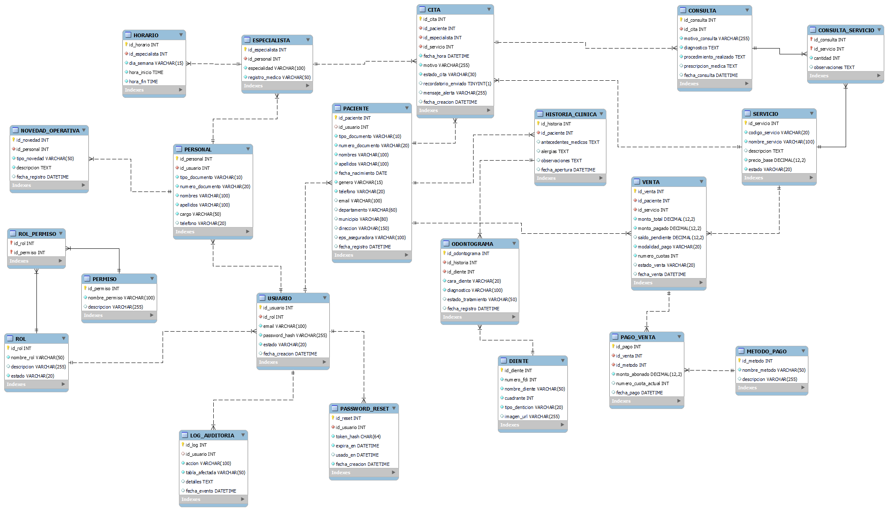

# DentalCare BD - Sistema de Gestión Odontológica

Este repositorio contiene la arquitectura, modelo relacional, scripts de base de datos y documentación técnica para el proyecto **DentalCare BD**, un sistema de información diseñado para la gestión integral de una clínica odontológica.

---

## Tecnologías Utilizadas

- **SGBD:** MySQL 8.0+ / MariaDB 10.4+
- **Herramientas de Administración:** MySQL Workbench, phpMyAdmin
- **Modelado:** StarUML / Diagramación Entidad-Relación
- **Control de Versiones:** Git y GitHub
- **Seguridad:** Cifrado de credenciales mediante algoritmo BCrypt (`$2a$10$`)

---

## Estructura del Repositorio

dentalcare_bd/
│
├── database/
│   ├── dentalcare_bd.sql          # Script principal: DDL (creación de base y 21 tablas en MAYÚSCULAS) + DML (datos semilla)
│   └── consultas_crud.sql         # Banco de pruebas: Operaciones CRUD (Create, Read, Update, Delete) para las 21 tablas
│
├── docs/
│   ├── README.md                  # Documentación técnica extendida
│   └── diagrama_er.png            # Diagrama Entidad-Relación oficial (21 entidades normalizadas v2)
│
└── README.md                      # Documentación principal del proyecto

Descripción del Modelo Relacional
La base de datos se encuentra normalizada hasta la Tercera Forma Normal (3FN) y está estructurada bajo la convención de nombres de tablas en MAYÚSCULAS para garantizar consistencia referencial y compatibilidad multiplataforma. Cubre los siguientes módulos funcionales:

Gestión de Seguridad, Usuarios y Roles: Control de acceso mediante roles (ROL, PERMISO, ROL_PERMISO, USUARIO, PASSWORD_RESET).

Administración de Personal y Especialistas: Registro de colaboradores, especialidades odontológicas y asignación de turnos (PERSONAL, ESPECIALISTA, HORARIO).

Pacientes e Historias Clínicas: Registro clínico de pacientes, antecedentes patológicos y apertura de historias (PACIENTE, HISTORIA_CLINICA).

Atención y Odontograma Digital: Mapeo anatómico dental y registro de hallazgos por pieza (DIENTE, ODONTOGRAMA).

Agenda y Actos Clínicos: Programación de citas y ejecución de consultas vinculadas a tratamientos del catálogo (CITA, CONSULTA, SERVICIO, CONSULTA_SERVICIO).

Facturación y Tesorería: Registro de ventas, planes de cuotas, saldos calculados y amortizaciones por medios de pago (VENTA, PAGO_VENTA, METODO_PAGO).

Auditoría y Soporte Operativo: Monitoreo de eventos y registro de incidencias técnicas en consultorios (LOG_AUDITORIA, NOVEDAD_OPERATIVA).

Instrucciones de Instalación e Importación
Para montar y desplegar la base de datos en tu entorno local:

Clonar el repositorio: `git clone https://github.com/jeidy94-git/dentalcare_bd.git` 

Importar la base de datos:

Importación de la Base de Datos (Estructura + Datos Semilla)
El script crea automáticamente el esquema dentalcare_bd y define las 21 tablas relacionales junto a sus registros iniciales.

Vía Terminal / Consola: mysql -u root -p < database/dentalcare_bd.sql
Vía phpMyAdmin / Workbench:
Abrir la pestaña Importar, seleccionar database/dentalcare_bd.sql y ejecutar (no requiere seleccionar una base de datos previa).

Ejecución del Banco de Consultas CRUD
Una vez importada la base de datos, ejecutar de forma independiente el archivo de pruebas:

Vía Terminal / Consola: mysql -u root -p dentalcare_bd < database/consultas_crud.sql
Vía phpMyAdmin / Workbench:
Abrir una pestaña SQL sobre la base dentalcare_bd, cargar el archivo database/consultas_crud.sql y ejecutar.

Crea la base de datos ejecutando CREATE DATABASE dentalcare_bd;.

Selecciona la base de datos y usa la opción Importar / Run SQL Script.

Selecciona el archivo database/dentalcare_bd.sql.

Diagrama Entidad-Relación (ER)
Puedes consultar el diagrama gráfico del modelo relacional en la carpeta docs/ o visualizarlo a continuación:

✒️ Autora
Jeidy - jeidy94-git
